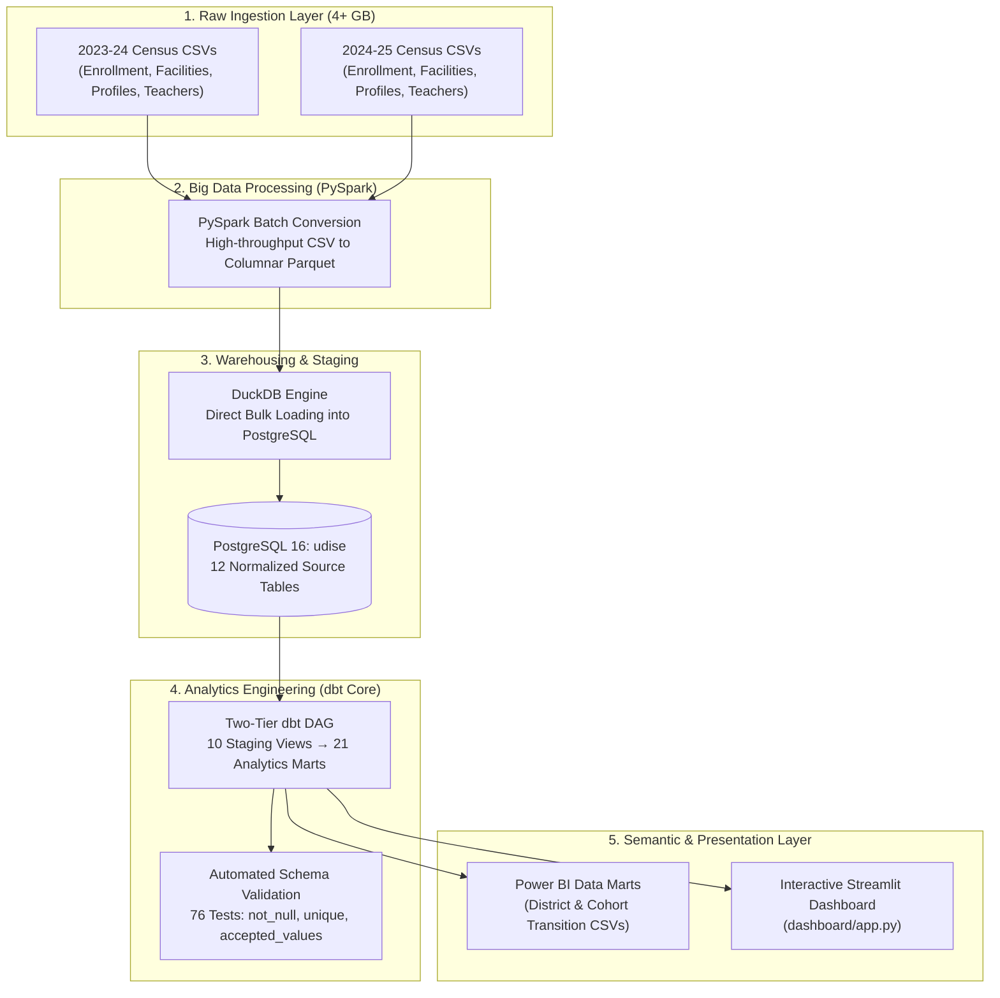

# UDISE+ National Educational Policy & Analytics Engine
### End-to-End Big Data Analytics Engineering on India's 1.47 Million Schools

[](https://python.org)
[](https://spark.apache.org)
[](https://postgresql.org)
[](https://getdbt.com)
[](https://streamlit.io)
[](https://duckdb.org)

---

## Executive Summary

The **Unified District Information System for Education (UDISE+)** is the official census and primary data backbone of school education in India, capturing details across **1.47+ million schools**, **9.5+ million teachers**, and **260+ million students** across 28 States and 8 Union Territories.

This project delivers an enterprise-grade **Modern Data Stack (MDS)** pipeline and analytical engine that ingests multi-year UDISE datasets (**2023–24** and **2024–25**), normalizes multi-gigabyte raw tables using **PySpark** and **DuckDB**, structures production data marts in **PostgreSQL** using **dbt**, and exposes evidence-based policy scorecards through an interactive **Streamlit Dashboard** and **Power BI Data Marts**.

Designed for **District Magistrates (DMs), Educational Administrators, and Public Policy Officers**, the system transforms raw administrative records into actionable interventions targeting dropout hot-spots, sanitation deficits, teacher misallocations, and socio-economic disparities.

---

## System Architecture



---

## Key Policy Problems Diagnosed & Solved

### 1. Gender Parity & Sanitation Infrastructure
* **Challenge:** High adolescent girl dropouts between Upper Primary (Class 8) and Secondary (Class 9).
* **Analytical Finding:** Transition rates for girls drop significantly in schools lacking functional, dedicated girls' toilets.
* **Metric:** Gender Parity Index ($GPI = \frac{\text{Girls}}{\text{Boys}}$) and Class 8→9 transition rate correlated with functional toilet indicators.

### 2. Pupil-Teacher Ratio (PTR) & RTE Compliance
* **Challenge:** Imbalances in rural vs. urban teacher deployments violating Right to Education (RTE) guidelines.
* **Standard:** RTE threshold is $\le 30:1$ for Primary and $\le 35:1$ for Secondary.
* **Metric:** Automated school-level PTR classification flagging `Under-staffed (PTR > 30)`, `Under-staffed (PTR > 35)`, and `Well-staffed` institutions.

### 3. Composite School Infrastructure Index (0–7)
* **Challenge:** Evaluating multiple isolated amenities (power, computers, toilets, library, water) without an aggregated score.
* **Metric:** A unified 7-point infrastructure scale assessing:
  1. Functional Electricity
  2. Functional Girls' Toilet
  3. Functional Boys' Toilet
  4. School Library Availability
  5. Playground Access
  6. Internet Connectivity
  7. Computer / ICT Laboratory

### 4. Student Progression Funnels & Repeater Rates
* **Challenge:** Locating critical educational leakages in the schooling lifecycle.
* **Metric:** Funnel tracking across **Pre-Primary $\to$ Class 1 Entry $\to$ Class 5 Exit $\to$ Class 8 Exit $\to$ Class 10 Exit $\to$ Class 12 Completion**, along with grade-wise repeater percentages.

### 5. Inter-Sectoral Health & Nutritional Linkage
* **Challenge:** Examining external socio-economic barriers affecting learning continuity.
* **Metric:** Joint analysis cross-referencing district BPL/EWS enrollment shares against **NFHS-5 child anemia rates** across states.

---

## dbt Model Architecture (Staging & Analytics Marts)

The analytical warehouse follows a two-tier dbt architecture with materialization strategies configured in `dbt_project.yml`:
* **Staging Layer (`models/staging/` — Materialized as Views):** Cleans, casts, and standardizes raw 2023–24 and 2024–25 census sources (`stg_profile1`, `stg_profile1_2425`, `stg_facilities`, `stg_facilities_2425`, `stg_enrollment1`, `stg_enrollment1_2425`, `stg_enrollment2`, `stg_enrollment2_2425`, `stg_teachers`, `stg_teachers_2425`).
* **Analytics Marts (`models/marts/` — Materialized as Tables):** Modular business logic consuming staging views via `ref()` for policy analysis and year-on-year comparisons.
* **Schema Validation & Tests:** 76 automated dbt tests including `not_null`, `unique` primary key constraints, and `accepted_values` validation on academic years.

### Analytics Marts Catalog (21 Production Models)

| Domain | Baseline Model (2023–24) | Year-on-Year Model (2023–24 vs 2024–25) | Analytical Scope |
| :--- | :--- | :--- | :--- |
| **Girls Retention & Infra** | `girls_retention_vs_infra` | `yoy_girls_retention_vs_infra` | Class 8→9 transition rate vs functional girls' toilets & power |
| **Teacher Allocation** | `ptr_and_teacher_allocation` | `yoy_ptr_and_teacher_allocation` | School-level PTR, RTE compliance flags, and teacher gender ratio |
| **Infrastructure Strength** | `infra_score_vs_enrollment` | `yoy_infra_score_vs_enrollment` | 7-point composite amenity score correlated with enrollment size |
| **Social & Regional Equity**| `regional_social_disparities` | `yoy_regional_social_disparities` | Rural vs Urban breakdown across General, SC, ST, and OBC groups |
| **Socio-Economic & Health** | `socio_economic_and_health_proxies` | `yoy_socio_economic_and_health_proxies` | BPL & EWS enrollments linked with NFHS-5 state child anemia rates |
| **School Management** | `school_management_and_facility_impact` | `yoy_school_management_and_facility_impact` | Govt vs Private Aided/Unaided facilities (Smart TVs, libraries) |
| **Aspirational Districts** | `girls_retention_aspirational_districts`| `yoy_girls_retention_aspirational_districts` | Rural school gender parity and critical disparity flags (<0.95) |
| **Transition Bottlenecks** | `transition_bottlenecks` | `yoy_transition_bottlenecks` | Progression drop-offs at Class 8→9 and Class 10→11 checkpoints |
| **Inclusion & CWSN** | `cwsn_enrolment_disability` | `yoy_cwsn_enrolment_disability` | Disaggregation across 21 RPwD Act disability classifications |
| **Age-Grade Distortion** | `age_grade_distortion` | `yoy_age_grade_distortion` | Class 1 Underage (<5), Normal-age (5–6), and Overage (>6) shares |
| **Progression Funnel** | `student_progression_funnel` | — | Macro cohort flow from Pre-Primary through Class 12 |

---

## Project Directory Structure

```text
UDISE/
├── dashboard/
│   ├── app.py                      # Interactive Streamlit analytics application
│   └── requirements.txt            # Dashboard dependencies (streamlit, plotly, etc.)
├── data/
│   ├── 2023-24/                    # Raw UDISE CSV census files (2023-24)
│   ├── 2023-24_parquet/            # Optimized Parquet tables (2023-24)
│   ├── 2024-25/                    # Raw UDISE CSV census files (2024-25)
│   ├── 2024-25_parquet/            # Optimized Parquet tables (2024-25)
│   ├── convert_all_to_parquet.py   # PySpark batch conversion (2023-24)
│   ├── convert_2024_25_to_parquet.py # PySpark batch conversion (2024-25)
│   └── powerbi_exports/            # Pre-aggregated dimensional data marts:
│       ├── district_policy_indicators.csv       (46,400+ district rows)
│       ├── cohort_transitions_state_district.csv (6,000+ cohort matrices)
│       └── nfhs5_state_anemia_rates.csv         (State health benchmarks)
├── dbt_udise/
│   └── udise_analytics/
│       ├── dbt_project.yml         # Staging (views) & Marts (tables) configurations
│       └── models/
│           ├── staging/            # 10 Staging views cleaning & standardizing raw census tables
│           │   ├── src_udise.yml   # Raw source definitions (public, public_2425)
│           │   └── stg_udise.yml   # Staging documentation & validation tests
│           └── marts/              # 21 Analytical marts
│               ├── policy/         # 11 Baseline policy marts
│               ├── yoy/            # 10 Year-on-Year comparative marts
│               └── marts_models.yml# Marts documentation, constraints, & accepted_values tests
├── python/
│   ├── UDISE_Data_Analysis.ipynb   # Exploratory PySpark & DuckDB analysis
│   └── load_2425_to_postgres.py    # Automated DuckDB-to-PostgreSQL loading (os.getenv configured)
├── sql/
│   └── enrollment1_analysis.sql    # Exploratory SQL analysis queries
├── .env.example                    # Template environment variables for DB credentials
└── Schema and Participant Brief/   # Official government schema manuals & PDFs
```

---

## Key Highlights & Takeaways
* **Data Scale:** 1.47 million schools analyzed across two full academic years (~4 GB raw census data).
* **High-Throughput Ingestion:** DuckDB-to-PostgreSQL direct attach engine for fast bulk loading.
* **Production dbt Architecture:** Two-tier DAG (`staging/` views $\to$ `marts/` tables) with 76 automated schema and constraint tests.
* **Actionable Outputs:** Filterable priority district matrices for resource allocation and infrastructure planning.

---
*Maintained for educational analytics, public policy evaluation, and evidence-based governance.*